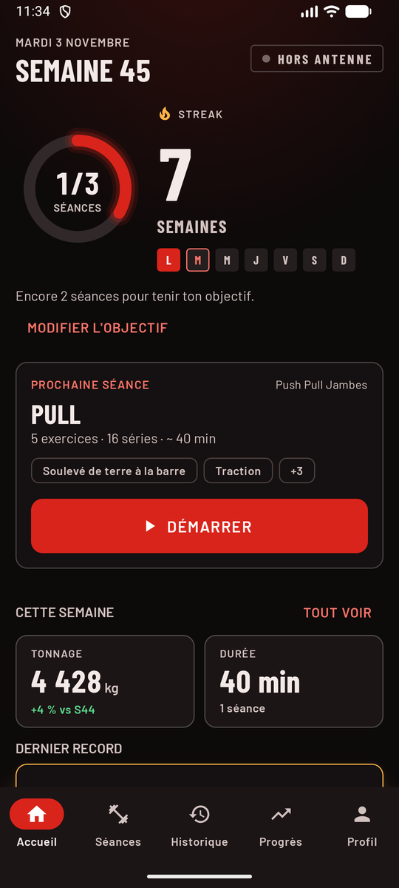
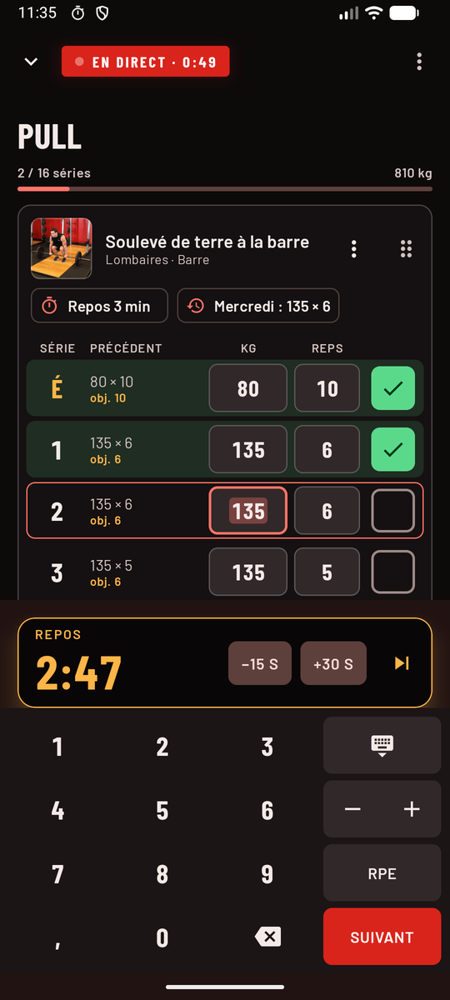
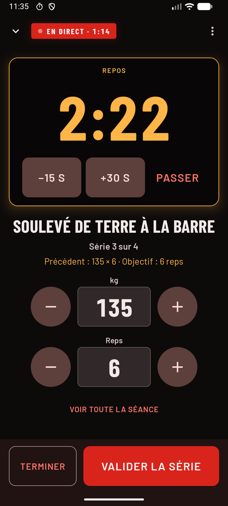
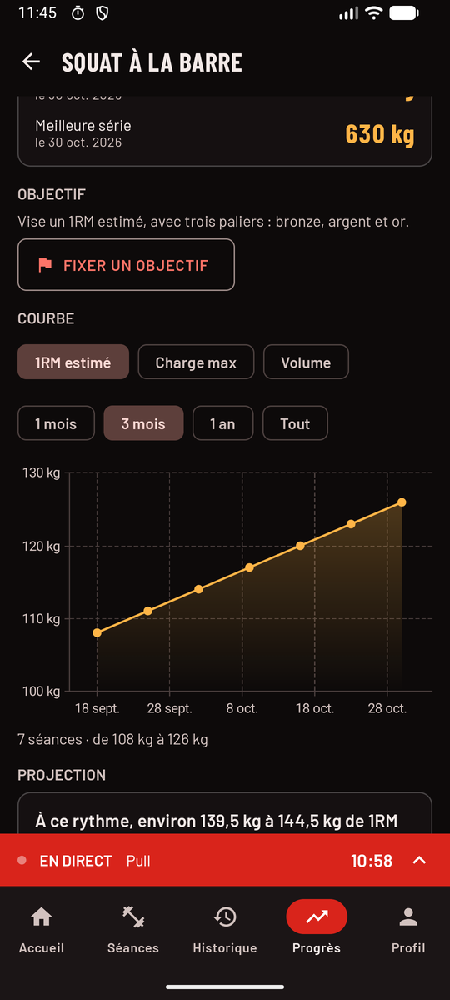
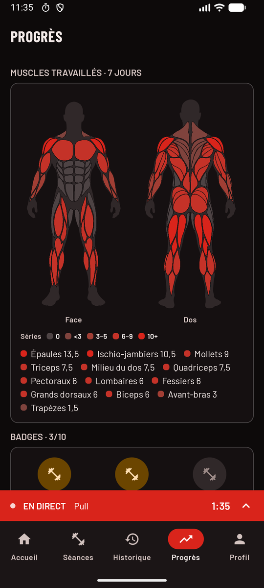
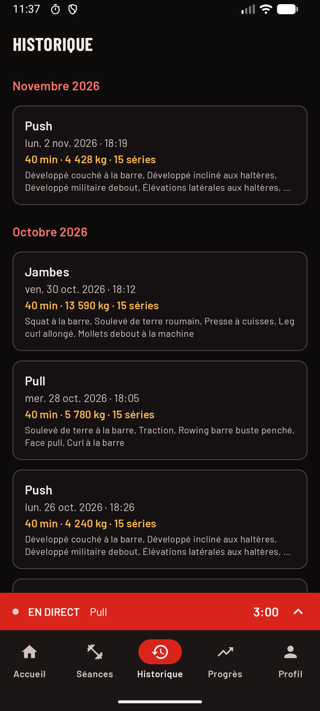

<p align="center">
  
</p>

<h1 align="center">LiftApp</h1>

<p align="center">
  <strong>Ton carnet de musculation, simple et hors ligne.</strong><br>
  Note tes séances, bats tes records, garde le rythme semaine après semaine.
</p>

<p align="center">
  <a href="https://github.com/paulfvt/liftapp/releases/latest"></a>
  
  <a href="https://github.com/paulfvt/liftapp/actions/workflows/ci.yml"></a>
  <a href="LICENSE"></a>
</p>

<p align="center">
  <a href="https://github.com/paulfvt/liftapp/releases/latest/download/LiftApp.apk"><strong>⬇ Télécharger LiftApp (APK)</strong></a>
</p>

---

LiftApp est une app Android gratuite de suivi de musculation, inspirée de Strong et Hevy. Pas de compte, pas de
pub, pas d'abonnement : tout reste sur ton téléphone. Elle mise sur une progression visible et motivante : records,
courbes, streak hebdomadaire et carte des muscles travaillés.

## Aperçu

<p align="center">
  
  
  
</p>
<p align="center">
  
  
  
</p>

## Fonctionnalités

**Préparer ses séances**
- Templates rangés en dossiers (Push, Pull, Jambes…), avec le type et les reps cibles de chaque série.
- 753 exercices en français avec leurs images, et tes propres exercices.
- La prochaine séance est proposée sur l'accueil, à lancer d'un appui (ou depuis le widget).

**Pendant la séance**
- Performance de la dernière fois à côté de chaque série, et séries pré-remplies.
- Pavé numérique intégré : − et + par 2,5 kg, « Suivant » qui valide la série et passe à la suivante.
- Minuteur de repos qui continue écran verrouillé : notification avec compte à rebours (Live Update sur
  Android 16), vibration 3 s avant la fin puis un « ding ding », même en silencieux.
- Mode salle : une série à la fois, chiffres géants, gros boutons, écran toujours allumé.
- Séries d'échauffement, de travail et dégressives, RPE, notes par exercice.

**Voir sa progression**
- Records automatiques : 1RM estimé, charge max, meilleure série, avec une célébration quand tu les bats.
- Courbes par exercice (1 mois à tout l'historique) et projection de ton 1RM à venir.
- Objectifs à paliers bronze, argent et or, badges, clubs des 100, 140 et 180 kg.
- Carte du corps des muscles travaillés sur 7 jours, souvenir d'une séance passée, récap du mois à partager.
- Mesures (poids, tours, masse grasse) et photos de progression protégées par un code ou ton empreinte.

**Tes données, chez toi**
- Aucune connexion : l'app ne demande même pas l'accès à internet.
- Sauvegarde complète dans un fichier ZIP, restauration sur un nouveau téléphone, export CSV lisible dans Excel.
- Kilos ou livres, centimètres ou pouces, thème sombre ou clair, widget d'écran d'accueil.

## Installer l'app

LiftApp n'est pas sur le Play Store : elle s'installe à partir du fichier APK publié ici.

1. Sur ton téléphone (Android 8.0 ou plus), télécharge **LiftApp.apk** depuis la
   [dernière version](https://github.com/paulfvt/liftapp/releases/latest).
2. Ouvre le fichier. La première fois, Android demande d'autoriser l'installation depuis ton navigateur ou ton
   gestionnaire de fichiers : accepte.
3. Si Play Protect prévient que l'app est inconnue, choisis « Plus de détails » puis « Installer quand même ».
4. À ta première séance, autorise les notifications et les « Alarmes et rappels » : c'est ce qui permet au minuteur
   de sonner à l'heure, écran verrouillé.

**Mettre à jour** : télécharge le nouvel APK et installe-le par-dessus, tes données sont gardées.

## Vie privée

Tout ce que tu saisis reste dans l'espace privé de l'app, sur ton téléphone. Rien n'est collecté ni envoyé, il n'y a
ni compte, ni publicité, ni mesure d'audience. Le détail est dans la
[politique de confidentialité](docs/politique-de-confidentialite.md).

## Pour les développeurs

**Stack** : Kotlin · Jetpack Compose · Material 3 · Navigation Compose · Room · DataStore · Hilt (KSP) · Coroutines et
Flow · Vico · Glance · CameraX · Coil · Biometric · GitHub Actions.

**Architecture** : trois couches recommandées par Android. Écrans Compose et ViewModels, domaine en Kotlin pur
(records, streak, projection, badges, entièrement testé), données avec Room et des repositories. Les règles du projet
sont dans [CLAUDE.md](CLAUDE.md), l'avancement phase par phase dans [PROGRESS.md](PROGRESS.md).

Ouvrir le dossier dans Android Studio et cliquer sur **Run**, ou en ligne de commande :

```bash
./gradlew ktlintCheck lintDebug testDebugUnitTest assembleDebug
```

C'est la commande de la CI. Les tests instrumentés (base de données, migrations, reprise d'une séance) se lancent
avec un émulateur ou un téléphone branché :

```bash
./gradlew installDebug installDebugAndroidTest
```

```bash
adb shell am instrument -w com.paulfvt.liftapp.test/androidx.test.runner.AndroidJUnitRunner
```

**Publier une version** :
1. Copier `keystore.properties.example` en `keystore.properties` (ignoré par Git) et le remplir avec la clé de la
   version publique. Toutes les versions doivent être signées avec la même clé, sinon elles ne s'installent pas
   par-dessus la précédente.
2. Augmenter `versionCode` et `versionName` dans `app/build.gradle.kts`.
3. Construire l'APK, puis le joindre à une release GitHub sous le nom `LiftApp.apk` :

   ```bash
   ./gradlew assembleRelease
   ```

   Il se trouve dans `app/build/outputs/apk/release/app-release.apk`.

## Crédits

- Catalogue d'exercices et images : [free-exercise-db](https://github.com/yuhonas/free-exercise-db) (Unlicense),
  traduit en français.
- Polices [Barlow](https://github.com/jpt/barlow) (SIL Open Font License 1.1).
- Tracés de la carte du corps : [MuscleMap](https://github.com/Jsplice/MuscleMap) (MIT).
- Icônes Material (Apache 2.0).

## Licence

Code sous licence [MIT](LICENSE). Les contenus tiers ci-dessus gardent leur propre licence, dont les textes sont
fournis dans l'app (Profil, « À propos »).
